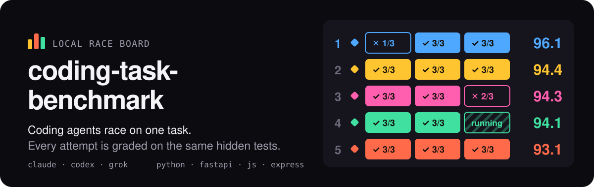
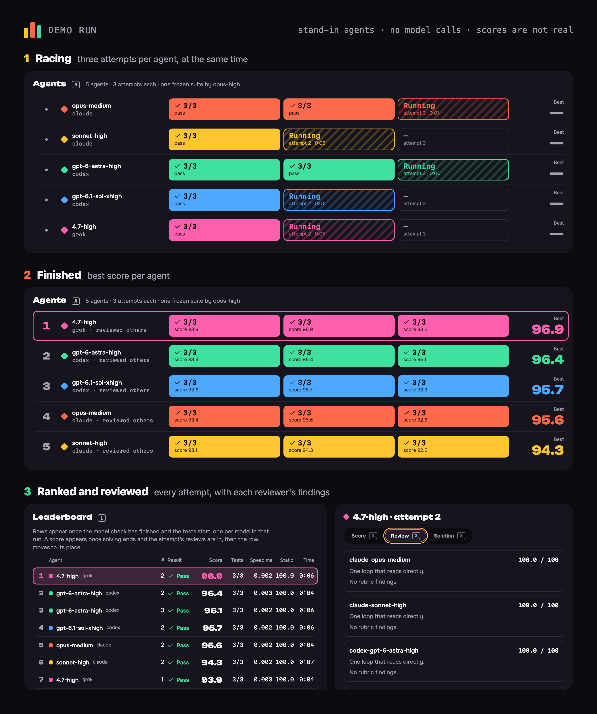
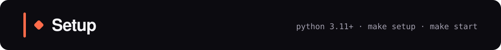
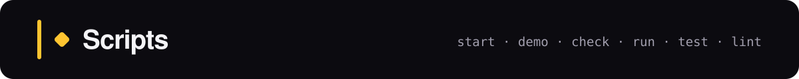
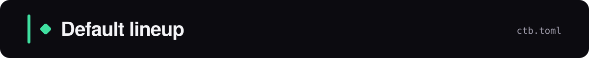
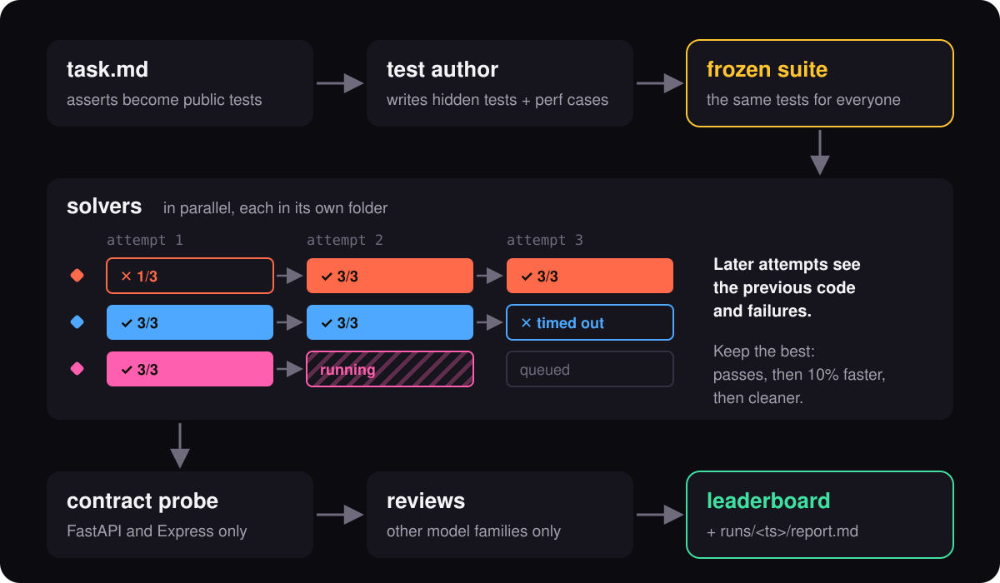
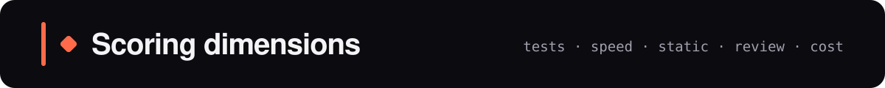
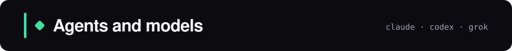

<p align="center"></p>

A local web page where coding-agent CLIs race on one programming task. Watch every attempt live, score your own solution on the same hidden tests, and compare them all on one leaderboard.

<p align="center"></p>

<p align="center"></p>

```bash
python3 --version   # needs 3.11 or newer
make setup
make start          # http://127.0.0.1:8765
```

<p align="center"></p>

```bash
make start                              # the page at http://127.0.0.1:8765
make demo                               # the page with an offline fake agent, no model calls
make check                              # prove each model in ctb.toml can run
make run TASK=examples/binary_gap.md    # race the ctb.toml lineup in the terminal, report in runs/
make practice TECH=python               # solve a task yourself in practice/, checked on every save
make test                               # run the tests
make lint                               # Ruff, plus a check for private paths and keys
```

<p align="center"></p>

Set in `ctb.toml` in the project root, read on startup:

```toml
# Default setup for `ctb ui`, `ctb check` and `ctb race`.
# Entries are cli:model:level. Leave the level out to use the CLI's default.

# Models that race on every task, three attempts each.
lineup = [
  "claude:opus:medium",
  "claude:sonnet:high",
  "codex:gpt-6-astra:high",
  "codex:gpt-6.1-sol:xhigh",
  "grok:grok-4.7:high",
]

# Writes the hidden tests. The first entry whose CLI is installed is used.
test_authors = [
  "claude:opus:high",
  "codex:gpt-6.1-sol:xhigh",
  "grok:grok-4.7:high",
]

# make practice: reads a pasted task's examples once. The first installed CLI is used.
practice = [
  "claude:haiku",
  "codex:gpt-6-luna:low",
  "grok:grok-4.7:low",
]

# Time limits in seconds.
[limits]
author = 900
solve = 300
review = 300
```

The report of a `ctb run` is `runs/<timestamp>/report.md`.

<p align="center"></p>

| Name | Shortcut | Purpose |
|---|---|---|
| Task | `T` | Paste the task and start the run |
| Your solution | `Y` | Score your own solution on the same tests |
| Agents | `A` | Each model's check and attempts |
| Leaderboard | `L`, then `↑` `↓` | Every attempt, ranked |
| Score, Review, Solution | `1` `2` `3` | The selected attempt's score, reviews and code |
| Hide solution | `H` | Blur or reveal the code on the Solution tab |
| Config | `C` | Models, reasoning levels, time limits and prompts |
| Message | `M` | Show a note to the people reviewing a screen recording |
| Leave a field | `Esc` | Return focus to the page |

<p align="center"></p>

<p align="center"></p>

<p align="center"></p>

| Dimension | How it's measured |
|---|---|
| Correctness | hidden tests passed; a failing public example scores 0 |
| Performance | median of 5 runs; the fastest passing solution scores 100 |
| Static | 70% function size and complexity, 30% linter (−10 per issue) |
| Review | each reviewer lists issues; start at 100, lose 25 per blocker, 10 per major, 3 per minor (not below 0); average across reviewers |
| Contract | share of bad-input probes that don't return a 500 |
| Cost | tokens and wall clock, lower is better |

<p align="center"></p>

| Tech | Picked when the task mentions | Linter | Review rubric |
|---|---|---|---|
| python | default | Ruff | [python.md](src/ctb/langs/python/python.md) |
| fastapi | FastAPI | Ruff + FastAPI rules | [fastapi.md](src/ctb/langs/python/fastapi.md) |
| javascript | JavaScript or Node | ESLint | [javascript.md](src/ctb/langs/node/javascript.md) |
| express | Express | ESLint | [express.md](src/ctb/langs/node/express.md) |

The Task box shows the detected language in its top-right corner, for example `Python auto`.
Click it to cycle through the four. All rubrics also include [common.md](src/ctb/langs/common.md).

Reviewers may only flag rules from the rubric. Lint issues, correctness and speed are out of scope.

<p align="center"></p>

Each entry is `cli`, `cli:model` or `cli:model:level`. Leave out the model or level to use the CLI's default.

| CLI | Levels | Solver sandbox | Watch out for |
|---|---|---|---|
| claude | low, medium, high, xhigh, max | none: can read any file your user can | |
| codex | low to ultra, per model | workspace only | ignores your `~/.codex/config.toml` |
| grok | low to xhigh, per model | workspace only | a new folder may stop on a trust prompt |

Reviewers get no write access in every CLI. The page lists each model's exact levels in Config.
